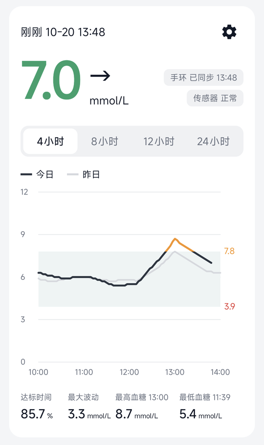
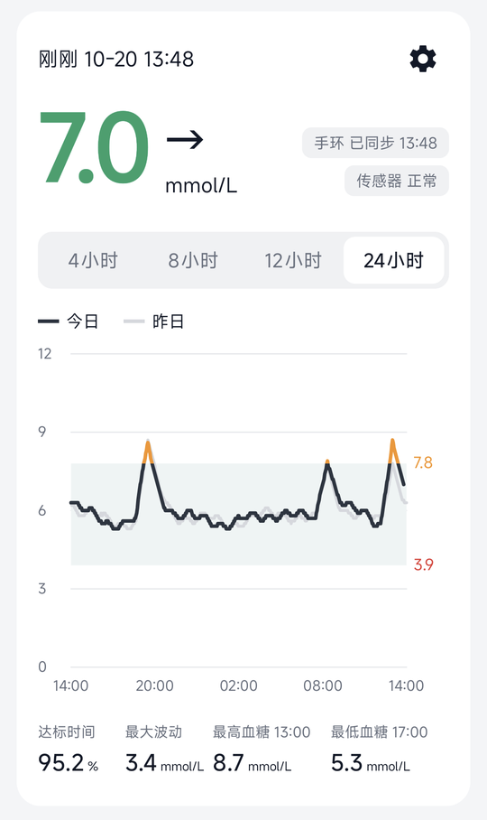
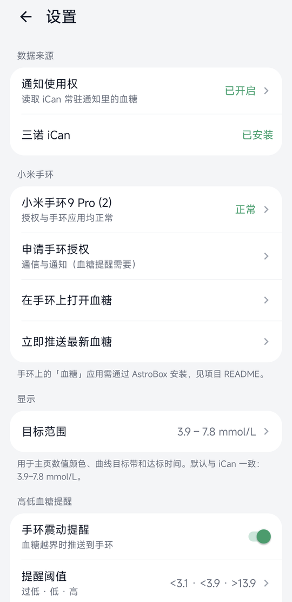
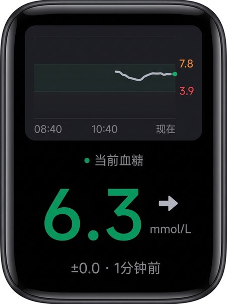

# 手环血糖（CGMBand）

把**三诺 iCan 动态血糖仪**的实时血糖，显示到手机上的曲线看板、**小米手环 9 Pro** 和 **Mac 菜单栏**上，并在血糖过高或过低时让手环震动提醒。

> ⚠️ 本项目只是方便查看的辅助工具，不是医疗器械。低血糖等报警请继续以三诺 iCan 官方 App 为准。

## 它能做什么

- **手机 App「手环血糖」**：
  - 最新血糖和趋势箭头，按目标范围着色；
  - 4/8/12/24 小时曲线，可叠加对比昨日；
  - 达标时间、最大波动、最高 / 最低血糖。
- **手环应用「血糖」**：抬腕打开就能看到当前血糖、趋势箭头和几分钟前测的；数据过期或传感器断开时会变灰。
- **高低血糖提醒**：血糖越界时手环弹通知并震动。持续没恢复会按间隔重复提醒，手环上的应用不用开着。
- **Mac 应用「血糖监测」（可选）**：菜单栏常驻显示当前血糖（如 `6.3 →`，按范围着色），点开有和手机一致的曲线看板。手机在同一 Wi-Fi 下自动连接，首次配对需在两边确认同一个 6 位配对码，数据全程加密。

<table>
  <tr>
    <td align="center"><br>手机主页 · 4 小时</td>
    <td align="center"><br>手机主页 · 24 小时</td>
    <td align="center"><br>设置页</td>
    <td align="center"><br>手环「血糖」应用</td>
  </tr>
</table>

> 手机截图中的血糖是 App 调试版内置的演示数据，不是真实记录；手环图是实拍照片，经 AI 去模糊、校正透视处理。

它的工作方式：

```
三诺传感器 ──蓝牙──> 三诺 iCan 官方 App（照常使用，报警、云同步都不受影响）
                          │ 读取它通知栏里的实时血糖（约 3 分钟一次）
                          ▼
                 手机 App「手环血糖」──经由小米运动健康──> 手环应用「血糖」
```

---

## 使用教程

### 你需要准备

| 项目 | 要求 | 已验证的版本 |
|---|---|---|
| 手机 | 安卓手机 | 小米 13 Ultra，HyperOS 3（Android 16） |
| 三诺 iCan | **国内版**官方 App，已绑定传感器并正常监测 | 2.5.1 |
| 手环 | 小米手环 9 Pro，已在「小米运动健康」里配对 | 小米运动健康 3.59.1 |
| 电脑 | macOS 或 Windows，加一根能传数据的 USB 线 | macOS（Apple 芯片） |
| 电脑工具 | [adb（Android platform-tools）](https://developer.android.com/tools/releases/platform-tools)，Python 3 | — |
| 安装包 | 手机安装包 `CGMBand-phone.apk`，手环安装包 `com.fch.cgmband.release.1.0.0.rpk` | — |

> **两个安装包必须出自同一次构建（同一个签名）**，否则手机和手环之间连不上。
> 可以向维护者要成对的安装包，也可以按文末「开发者说明」自己构建，产物在 `out/` 目录。

整个流程大约 20 分钟，按顺序做完下面 6 步即可。

### 第一步：打开 USB 调试，连接电脑

1. 手机进入「设置 → 我的设备 → 全部参数与信息」，连续点「OS 版本」7 次，开启开发者模式。
2. 回到「设置 → 更多设置 → 开发者选项」，打开「**USB 调试**」。小米手机建议同时打开「**USB 安装**」。
3. 用数据线连接电脑。手机弹出「允许 USB 调试吗？」时，点允许。
4. 在电脑终端运行 `adb devices`，能看到一行 `xxxxxxxx  device` 就说明连上了。

### 第二步：获取手环的 AuthKey

AstroBox 需要用 AuthKey 才能连接你的手环。AuthKey 就是小米运动健康和手环之间的配对密钥。

1. 打开「小米运动健康」，在「设备」页下拉同步一次。
2. 进入「我的 → 关于」，**快速连点小米运动健康的图标 10 次以上**，弹窗里点「确定」，这一步是打开调试日志。
3. 回到「设备」页，再同步一次。
4. 在本项目目录下运行：

   ```bash
   python3 tools/extract_authkey.py --copy
   ```

   正常的输出类似下面这样，AuthKey 是一串 32 位的字母数字，macOS 上会自动复制到剪贴板：

   ```
   小米手环9 Pro	0123456789abcdef0123456789abcdef
   ```

> 🔒 **AuthKey 相当于手环的钥匙，不要发给别人。**
> AstroBox 里也有「登录小米账号导入设备」的入口，**不建议使用**，因为那等于把小米账号交给第三方工具。

### 第三步：用 AstroBox 连接手环

[AstroBox](https://astrobox.online) 是开源的小米穿戴第三方工具，用来把应用装到手环上。小米官方的安装渠道只对合作开发者开放，所以这里用它。

1. **下载安装 AstroBox**：从 GitHub 的 [AstralSightStudios/AstroBox-NG 发布页](https://github.com/AstralSightStudios/AstroBox-NG/releases) 下载对应系统的安装包。
   Apple 芯片的 Mac 选 `aarch64.dmg`，Intel Mac 选 `x64.dmg`。
   - macOS 版没有经过苹果公证。如果双击打不开，在「应用程序」里右键点 AstroBox，选「打开」。
   - 首次启动时允许它使用蓝牙。如果它要求登录，那是 AstroBox 自己的账号，用邮箱注册即可，**不要登录小米账号**。
2. **让手环进入配对模式**：在手环上进入「设置 → 系统操作 → 连接新手机」。
   这一步只是临时允许新设备连接，**不会清除手环数据**。如果看到「恢复出厂设置」或「解除绑定」，不要点，退回去重新找。
3. **连接**：在 AstroBox 里打开「设备」，搜索设备，点选「小米手环9 Pro」。
   在「设备密钥」处粘贴第二步拿到的 AuthKey，再点右侧的小飞机图标。
   连接成功后，AstroBox 里会显示手环的信息。

### 第四步：在手环上安装「血糖」应用

1. 在 AstroBox 里点「队列」图标（在「设置」上方，像一个列表）。
2. 点右上角，资源类型选「**快应用**」，然后选择 `com.fch.cgmband.release.1.0.0.rpk`。
   如果文件选择框停在「最近」，点左上角的三条横线，切到下载目录或其他目录去找。
3. 开始安装，等待提示安装成功。
4. **关掉 AstroBox**，让手环退出配对页面，等它自动连回小米运动健康，通常不到一分钟。
   如果一直连不上，把手机蓝牙关掉再打开。
5. 在手环上从表盘底部上滑，打开应用列表，应该能看到「血糖」。

### 第五步：在手机上安装「手环血糖」App

任选一种方式：

- **用电脑安装**：运行 `adb install -r out/CGMBand-phone.apk`。
  如果提示 `INSTALL_FAILED_USER_RESTRICTED`，到开发者选项里打开「USB 安装」后重试。
- **在手机上安装**：把 APK 文件传到手机上，点击安装，按提示允许「安装未知来源应用」。

### 第六步：首次设置（很重要，少一步都可能收不到数据）

打开「手环血糖」，先点「允许」通知权限，然后按顺序完成下面几项：

1. **通知使用权**：主页顶部有一条橙色提示，点它，或者点右上角齿轮进入设置。在「数据来源 → 通知使用权」里找到「手环血糖」并打开。
   App 是从 iCan 的通知里读血糖的，这一项必须开。
2. **后台运行**：HyperOS 会冻结后台应用，冻结后血糖可能延迟二十多分钟才推送。在设置的「后台运行」里：
   - 「电池优化」点进去，选择允许；
   - 「自启动与省电策略」点进去，打开「自启动」，省电策略选「**无限制**」。
3. **锁定后台**：在手机的最近任务里，下拉「手环血糖」的卡片把它锁定。
4. **手环授权**：在设置的「小米手环」里点「申请手环授权」，完成后手环那一行应显示绿色的「正常」。
5. **测试提醒**：在设置的「高低血糖提醒」里点「发送测试提醒」，手环应该震动并显示「血糖提醒测试」。
6. **打开手环应用**：点「在手环上打开血糖」，手环上应该能看到当前血糖。

设置完成后回到主页，能看到最新血糖，右侧显示「手环 已同步 HH:mm」，就说明全部打通了。🎉

---

### 可选：在 Mac 菜单栏显示血糖

需要 Apple 芯片的 Mac、macOS 14 及以上，以及 Xcode 或其命令行工具（`xcode-select --install`）。

1. 构建并打开 Mac 应用：

   ```bash
   macos/build.sh
   open "macos/血糖监测.app"
   ```

   首次启动时，系统可能会询问是否允许它访问本地网络，请允许。之后可以把 `血糖监测.app` 拖进「应用程序」。
2. 确认手机和 Mac 连着**同一个 Wi-Fi**。
3. 在手机 App 的「设置 → Mac 桌面端」里，会出现「配对「你的 Mac 名字」」，点它。
4. 手机和 Mac 会**各自弹出一个 6 位配对码**。确认两边的数字一致后，在两边都点「配对」。
5. 配对完成后，菜单栏会显示当前血糖。以后只要在同一 Wi-Fi 下，手机都会自动连上，锁屏时也一样，不用再配对。

Mac 应用的菜单栏里可以打开主窗口和「设置…」（已配对的手机、目标范围、诊断日志）。

## 日常使用

### 手机主页

- **血糖数值的颜色**：
  - 绿色：在目标范围内；橙色：偏高；红色：偏低。
  - 灰色：数据超过 10 分钟没更新、测量时间未知、或传感器未连接。灰色的数值**不代表当前血糖**。
- **右上角两个状态**：
  - 「手环 已同步 HH:mm」：最近一次成功推送到手环的时间。
  - 「传感器 正常 / 未连接」：来自 iCan 的状态。
- **曲线**：
  - 可以切换 4、8、12、24 小时；黑线是今天，灰线是昨天同一时段。
  - 浅色带是目标范围，默认 3.9–7.8 mmol/L，和 iCan 一致。曲线超出上限的部分画成橙色，低于下限的部分画成红色。
- **统计**：达标时间、最大波动、最高 / 最低血糖，都按当前选中的时间段计算。
- 曲线数据保存在手机本地，保留 14 天。**iCan 里原有的历史数据读不到**，所以曲线从安装本 App 时开始积累，「昨日」那条线第二天才会出现。

### 手环上的「血糖」

- 从表盘底部上滑打开应用列表，点「血糖」。
- **建议把它放到应用列表第一位**：在小米运动健康里进入「设备 → 系统设置 → 应用顺序管理」，把「血糖」拖到最上面。之后上滑一下、点一下就能看到。
- **上半部分是最近 4 小时的曲线**，配色和手机 App 一致：在目标范围内是浅灰色，偏高是橙色，偏低是红色。浅色带是目标范围，右侧标着上下限。
- **下半部分是当前血糖**：大号数值（绿色在范围内，橙色偏高，红色偏低，LO 为红色、HI 为橙色），旁边是趋势箭头和单位；最下面一行灰字类似「+0.2 · 3分钟前」。
- 每次打开都会主动向手机要最新值和曲线，所以显示的总是最新数据。超过 10 分钟没有新数据时数值会变灰，灰字改为提示「数据已过期」；传感器断开、时间未知、手机未连接时也会在这一行提示。

### 高低血糖提醒

| 区间 | 默认阈值（mmol/L） | 一直没恢复时的重复间隔 |
|---|---|---|
| 过低 | < 3.1，或 iCan 显示 LO | 10 分钟 |
| 低 | < 3.9 | 20 分钟 |
| 高 | > 13.9，或 iCan 显示 HI | 60 分钟 |

- 进入某个区间时立即提醒；从「低」恶化到「过低」也会立即提醒。
- 超过 15 分钟的旧读数不会触发提醒。
- 阈值和开关在「设置 → 高低血糖提醒」里修改。

### 通知栏的「手环血糖 · 正在同步到手环」

这是让 App 在后台持续工作的常驻通知，上面也会显示最新血糖。**请不要关闭它**，关掉后系统可能冻结 App。

---

## 常见问题

**主页一直显示「等待 iCan 数据」**
- 确认「设置 → 数据来源 → 通知使用权」是「已开启」。
- 确认 iCan 正在监测：手机通知栏里应该有一条 iCan 的常驻通知，上面显示着血糖。
- 确认已开启自启动（见第六步）。

**手环或主页显示「数据已过期」，或者推送明显延迟**
- 多半是 App 被系统冻结了。检查第六步第 2、3 项是否都已完成。
- 重新安装 App 后，HyperOS 可能会把「自启动」关掉，需要重新打开。

**收不到高低血糖提醒**
- 先点「发送测试提醒」试一下。
- 收不到的话，点「申请手环授权」，确认手环那一行显示「正常」。
- 检查手环是否开了勿扰模式。

**手环上的「血糖」打不开，或者手机上显示「手环应用未安装」**
- 用 AstroBox 重新安装手环应用（第三、四步）。
- 确认手机 App 和手环应用是同一次构建的安装包。

**手环显示「时间未知」，或者 iCan 升级后主页不再更新**
- iCan 新版本可能改了通知的格式，需要适配，请把 iCan 的版本号反馈给维护者。

**能不能把血糖做到表盘上？**
- 目前做不到。手环上的应用退到后台就会被系统停止，表盘也没有接收手机数据的途径，表盘上只能显示旧值，反而容易误导。
- 替代办法是把「血糖」放到应用列表第一位，再配合高低血糖震动提醒。

**换手机或卸载重装会怎样？**
- 曲线历史保存在手机本地，卸载后会丢失。
- 手环上的应用不需要重装，前提是新装的手机 App 来自同一个签名。

**Mac 菜单栏一直显示「等待手机连接」**
- 手机和 Mac 必须在同一个 Wi-Fi 下。部分公司或公共 Wi-Fi 开了「客户端隔离」，设备之间互相访问不了，这种网络下无法使用。
- 手机 App「设置 → Mac 桌面端」里，「同步到 Mac」要打开，Mac 要显示为「已配对」。如果显示「需要重新配对」，点它重新配对即可。
- 手机开着 VPN 时，要确认 VPN 没有接管局域网流量（多数 VPN 应用都有「绕过局域网」选项）。
- Mac 端「设置… → 诊断日志」和手机端「设置 → 诊断 → 运行日志」里都有连接过程的记录。

## 隐私与安全

- 血糖数据只在你的手机、手环和 Mac 之间传递，**不会上传到任何服务器**，也不参与系统备份和换机迁移。
- 手机到 Mac 只走局域网，首次需要人工确认配对码，之后端到端加密（ECDH + AES-GCM），同一网络里的其他人看不到也伪造不了。
- App 虽然有读取通知的权限，但只解析三诺 iCan 的那一条常驻通知，其他应用的通知一律不读。
- AuthKey、签名文件（`keystore/`）都是私密信息，已经被 git 忽略，请不要分享。

---

## 开发者说明

### 目录结构

| 路径 | 内容 |
|---|---|
| `android/` | 手机端 Kotlin 工程。`core/` 是纯逻辑，有 JVM 单元测试；其余是 Android 组件 |
| `band/` | 手环端 Vela JS 快应用（aiot-toolkit 2.x），有 Node 单元测试 |
| `macos/` | Mac 菜单栏应用（SwiftUI + Network.framework + CryptoKit，`swiftc` 直接编译），`test.sh` 跑单元测试、协议测试向量和端到端测试 |
| `docs/` | `desktop-protocol.md`：手机 ↔ Mac 的发现、配对和加密协议，附测试向量 |
| `tools/` | `create_keystore.sh` 生成签名，`fetch_xms_sdk.sh` 下载小米穿戴 SDK，`build_release.sh` 一键构建，`extract_authkey.py` 提取 AuthKey |
| `keystore/` | 两端共用的签名和 AuthKey。被 git 忽略，丢了就得两端一起重新签名、重新安装 |

### 构建

```bash
tools/create_keystore.sh     # 只需运行一次：生成 keystore/ 和 band/sign/（不会覆盖已有签名）
tools/build_release.sh       # 下载 SDK + 两端单元测试 + 构建，产物输出到 out/
macos/test.sh && macos/build.sh   # Mac 应用：测试 + 构建（不需要签名文件）
```

小米穿戴 SDK（`xms-wearable-lib_1.4_release.aar`）没有放进仓库。`tools/fetch_xms_sdk.sh` 会从小米官方的 Vela 示例包下载它并校验 SHA-256，`build_release.sh` 会自动调用。

依赖：JDK 17、Android SDK 36、Node 22.7 及以上、OpenSSL。

开发时可以直接构建 debug 版：

```bash
tools/fetch_xms_sdk.sh       # 首次需要
cd android && ./gradlew :app:testDebugUnitTest :app:assembleDebug
adb install -r app/build/outputs/apk/debug/app-debug.apk
```

### 截图用的演示模式

调试版（debug）App 内置演示数据，只替换主页显示，不写数据库、不推送到手环，高低血糖提醒仍按真实读数工作，10 分钟后自动关闭：

```bash
adb shell am start -n com.fch.cgmband/.MainActivity --ez demo true    # 开启
adb shell am start -n com.fch.cgmband/.MainActivity --ez demo false   # 关闭
```

### 关键约束

- **包名和签名必须两端一致**（`com.fch.cgmband`），否则小米的设备通信接口（interconnect）会直接拒绝连接。
- 手环 9 / 9 Pro 不能联网，手环应用只在前台运行时才能收到消息。所以手机会缓存最新读数，手环打开应用时会发 `sync` 请求来取。
- **读数来源**：读取 iCan 通知的自定义布局（RemoteViews），按控件的资源名取值。
  - v2.5.x 的控件名是 `tv_cgm_value` / `tv_cgm_unit` / `tv_cgm_time`；
  - v2.4.x 是 `new_blood_tv` / `new_blood_unit_tv`。
  - iCan 升级后如果读不到数，先用 `uiautomator dump` 查看通知里的新控件名，再修改 `NotificationParser`。
- **测量时间**由通知上的 `HH:mm`，结合通知的发布时间（`sbn.postTime`）推算出日期。推算不出来时为 `null`，**绝不拿"现在"兜底**，避免把旧值显示成新值。
- **趋势箭头**由手机端根据最近两次读数自己计算（阈值是每分钟 1 / 2 / 3 mg/dL），不去识别 iCan 的箭头图标。
- **HyperOS 后台限制**：
  - 不开自启动，系统会拒绝绑定通知监听服务，日志里会出现 `AutoStartManagerService: Reject service`。
  - 冻结器（`dumpsys greezer`）会让通知回调积压。为此 App 带了一个前台服务 `KeepAliveService`，并且需要加入电池优化白名单，前台服务才能在后台被拉起。

### 消息协议（JSON 字符串）

手机发给手环：

```json
{"type":"bg","value":"6.6","unit":"mmol/L","mmol":6.6,"time":"16:33",
 "ts":1792398000000,"trend":"FLAT","delta":0.1,"connected":true}
```

| 字段 | 含义 |
|---|---|
| `value` | iCan 显示的原文，可能是 `LO` / `HI` |
| `mmol` | 换算成 mmol/L 的数值；不是数字时为 `null` |
| `ts` | 测量时间（毫秒时间戳），推不出来时为 `null`，手环据此判断「几分钟前」和是否过期 |
| `trend` | 趋势：`DOUBLE_UP` / `SINGLE_UP` / `FORTY_FIVE_UP` / `FLAT` / `FORTY_FIVE_DOWN` / `SINGLE_DOWN` / `DOUBLE_DOWN` / `NONE` |
| `delta` | 与上一次读数的差值（mmol/L）；没有上一次时为 `null` |
| `connected` | 传感器是否连接；为 `false` 时重发上一条读数，`ts` 保持不变 |

- 时间更早的读数不会覆盖更新的读数。
- 最新值是 LO / HI 时，`trend` 为 `NONE`，`delta` 为 `null`。

每条 `bg` 之后（以及回复 `sync`、修改目标范围时），手机还会发一条最近 4 小时的历史，供手环画曲线：

```json
{"type":"history","ref":1792398000000,"range":[3.9,7.8],"points":[[240,66],[237,65],[3,62],[0,61]]}
```

| 字段 | 含义 |
|---|---|
| `ref` | 最新一个点的测量时间（毫秒时间戳）；没有历史时为 `null`，此时 `points` 为空数组 |
| `range` | 目标范围 `[下限, 上限]`（mmol/L），手环用它给曲线和数值着色 |
| `points` | `[距 ref 的分钟数, mmol/L×10]`，按时间从早到晚排列，最多 100 个点，必要时抽稀但一定保留最新点 |

手环发给手机：`{"type":"sync"}`，表示要手机重发最新一条读数和历史。

### 排错

| 现象 | 处理 |
|---|---|
| 想看手机端日志 | `adb logcat -s CgmBand CgmExtractor`；App 的「设置 → 诊断 → 运行日志」里也能看 |
| `AppNotInstalledException` | 手环上没装应用，或者两端包名不一致 |
| `SignatureVerifyFailedException` | rpk 和 APK 的签名不一致 |
| 通知监听不工作 | 看 `adb shell dumpsys notification` 的 "Live notification listeners" 里有没有 `com.fch.cgmband` |
| 怀疑被系统冻结 | `adb shell dumpsys greezer \| grep <uid>`，不应出现新的 `FZ` 记录 |
